# Image-Handling-and-Pixel-Transformations-Using-OpenCV 

## AIM:
Write a Python program using OpenCV that performs the following tasks:

1) Read and Display an Image.  
2) Adjust the brightness of an image.  
3) Modify the image contrast.  
4) Generate a third image using bitwise operations.

## Software Required:
- Anaconda - Python 3.7
- Jupyter Notebook (for interactive development and execution)

## Algorithm:
### Step 1:
Load an image from your local directory and display it.

### Step 2:
Create a matrix of ones (with data type float64) to adjust brightness.

### Step 3:
Create brighter and darker images by adding and subtracting the matrix from the original image.  
Display the original, brighter, and darker images.

### Step 4:
Modify the image contrast by creating two higher contrast images using scaling factors of 1.1 and 1.2 (without overflow fix).  
Display the original, lower contrast, and higher contrast images.

### Step 5:
Split the image (boy.jpg) into B, G, R components and display the channels

## Program Developed By:
- **Name:** Eswar S
- **Register Number:** 212225230067

### Ex. No. 01

#### 1. Read the image ('Eagle_in_Flight.jpg') using OpenCV imread() as a grayscale image.
```python
img = cv2.imread("Eagle_in_Flight.jpg")
```

#### 2. Print the image width, height & Channel.
```python
height, width = img.shape[:2]
channel = 1 if len(img.shape) == 2 else img.shape[2]
print("Width:", width)
print("Height:", height)
print("Channel:", channel)
```

#### 3. Display the image using matplotlib imshow().
```python
plt.imshow(img, cmap="gray")
plt.title("Grayscale Image")
plt.show()
```

#### 4. Save the image as a PNG file using OpenCV imwrite().
```python
cv2.imwrite("Eagle.png", img)
```

#### 5. Read the saved image above as a color image using cv2.cvtColor().
```python
img_color = cv2.imread("Eagle.png")
img_color = cv2.cvtColor(img_color, cv2.COLOR_BGR2RGB)
```

#### 6. Display the Colour image using matplotlib imshow() & Print the image width, height & channel.
```python
print("Color Image Shape:", img_color.shape)
plt.imshow(img_color)
plt.title("Color Image")
plt.show()
```

#### 7. Crop the image to extract any specific (Eagle alone) object from the image.
```python
crop = img_color[100:400, 100:500]
plt.imshow(crop)
plt.title("Cropped Image")
plt.show()
```

#### 8. Resize the image up by a factor of 2x.
```python
resized = cv2.resize(crop, None, fx=2, fy=2)
plt.imshow(resized)
plt.title("Resized Image")
plt.show()
```

#### 9. Flip the cropped/resized image horizontally.
```python
flipped = cv2.flip(resized, 1)
plt.imshow(flipped)
plt.title("Flipped Image")
plt.show()
```

#### 10. Read in the image ('Apollo-11-launch.jpg').
```python
apollo = cv2.imread("Apollo-11-launch.jpg")
apollo = cv2.cvtColor(apollo, cv2.COLOR_BGR2RGB)
```

#### 11. Add the following text to the dark area at the bottom of the image (centered on the image):
```python
text = 'Apollo 11 Saturn V Launch, July 16, 1969'
font_face = cv2.FONT_HERSHEY_PLAIN
cv2.putText(apollo, text, (50, apollo.shape[0]-30),cv2.FONT_HERSHEY_PLAIN, 2, (255,255,255), 2)
```

#### 12. Draw a magenta rectangle that encompasses the launch tower and the rocket.
```python
rect_color = magenta
cv2.rectangle(apollo, (300,100), (700,700), (255,0,255), 3)
```

#### 13. Display the final annotated image.
```python
plt.imshow(apollo)
plt.title("Apollo Launch")
plt.show()
```

#### 14. Read the image ('Boy.jpg').
```python
img = cv2.imread("boy.jpg")
```

#### 15. Adjust the brightness of the image.
```python
matrix_ones = np.ones(img.shape, dtype="uint8") * 50
```

#### 16. Create brighter and darker images.
```python
img_brighter = cv2.add(img, matrix_ones)
img_darker = cv2.subtract(img, matrix_ones)
```

#### 17. Display the images (Original Image, Darker Image, Brighter Image).
```python
plt.figure(figsize=(12,5))
plt.subplot(1,3,1)
plt.imshow(cv2.cvtColor(img, cv2.COLOR_BGR2RGB))
plt.title("Original")
plt.subplot(1,3,2)
plt.imshow(cv2.cvtColor(img_darker, cv2.COLOR_BGR2RGB))
plt.title("Darker")
plt.subplot(1,3,3)
plt.imshow(cv2.cvtColor(img_brighter, cv2.COLOR_BGR2RGB))
plt.title("Brighter")
plt.show()
```

#### 18. Modify the image contrast.
```python
matrix1 = np.ones(img.shape, dtype="float32") * 1.1
matrix2 = np.ones(img.shape, dtype="float32") * 1.2
img_lower = cv2.convertScaleAbs(img, alpha=0.8, beta=0)
img_higher1 = cv2.multiply(img.astype("float32"), matrix1)
img_higher2 = cv2.multiply(img.astype("float32"), matrix2)
img_higher1 = np.clip(img_higher1, 0, 255).astype("uint8")
img_higher2 = np.clip(img_higher2, 0, 255).astype("uint8")
```

#### 19. Display the images (Original, Lower Contrast, Higher Contrast).
```python
plt.figure(figsize=(12,5))
images = [img, img_lower, img_higher1, img_higher2]
titles = ["Original", "Lower Contrast", "Contrast 1.1", "Contrast 1.2"]
for i in range(4):
    plt.subplot(1,4,i+1)
    plt.imshow(cv2.cvtColor(images[i], cv2.COLOR_BGR2RGB))
    plt.title(titles[i])
    plt.axis("off")
plt.show()
```

#### 20. Split the image (boy.jpg) into the B,G,R components & Display the channels.
```python
b, g, r = cv2.split(img)
plt.figure(figsize=(12,4))
for i, (channel, title) in enumerate(zip([b,g,r], ["Blue","Green","Red"])):
    plt.subplot(1,3,i+1)
    plt.imshow(channel, cmap="gray")
    plt.title(title)
plt.show()
```

#### 21. Merged the R, G, B , displays along with the original image
```python
merged = cv2.merge([r,g,b])
plt.imshow(merged)
plt.title("Merged RGB Image")
plt.show()
```

#### 22. Split the image into the H, S, V components & Display the channels.
```python
hsv = cv2.cvtColor(img, cv2.COLOR_BGR2HSV)
h, s, v = cv2.split(hsv)
plt.figure(figsize=(12,4))
for i, (channel, title) in enumerate(zip([h,s,v], ["Hue","Saturation","Value"])):
    plt.subplot(1,3,i+1)
    plt.imshow(channel, cmap="gray")
    plt.title(title)
plt.show()
```
#### 23. Merged the H, S, V, displays along with original image.
```python
merged_hsv = cv2.merge([h,s,v])
final_image = cv2.cvtColor(merged_hsv, cv2.COLOR_HSV2RGB)
plt.imshow(final_image)
plt.title("Merged HSV Image")
plt.show()
```

## Output:
- **i)** Read and Display an Image.

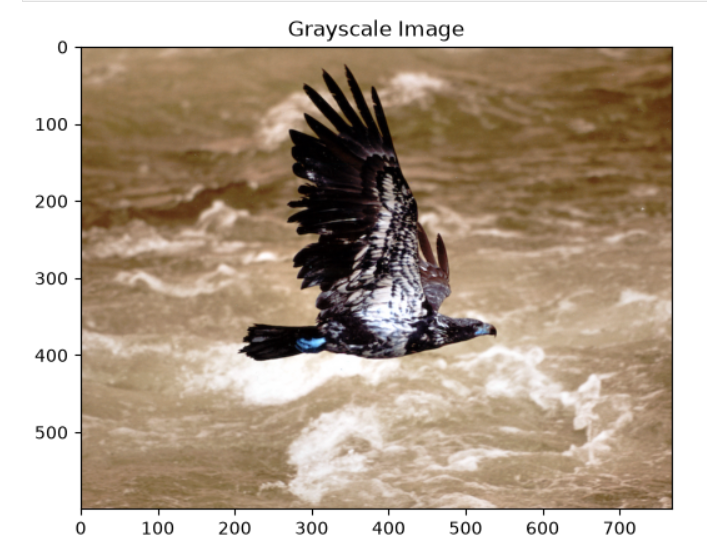 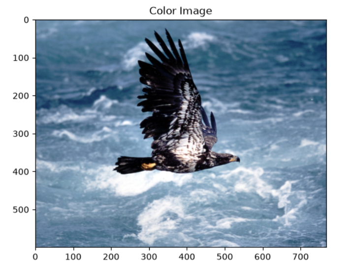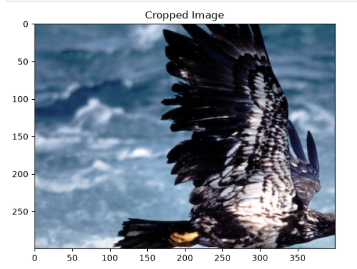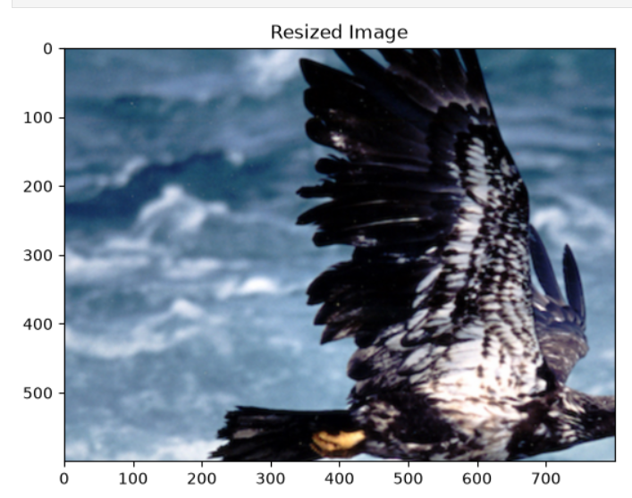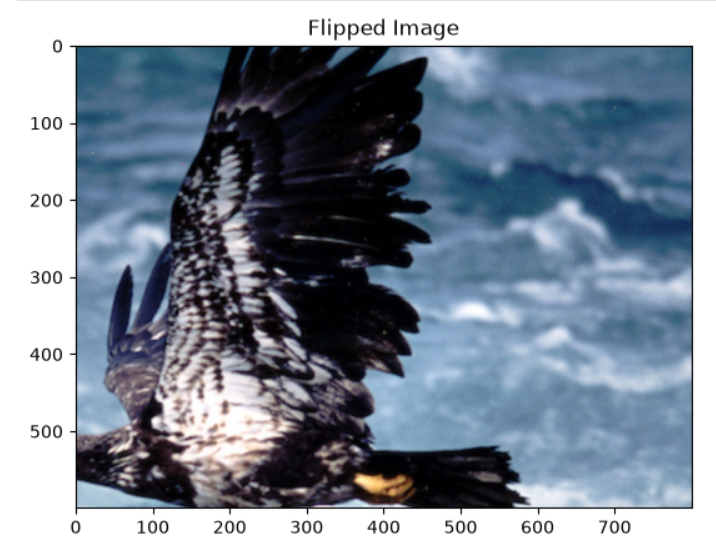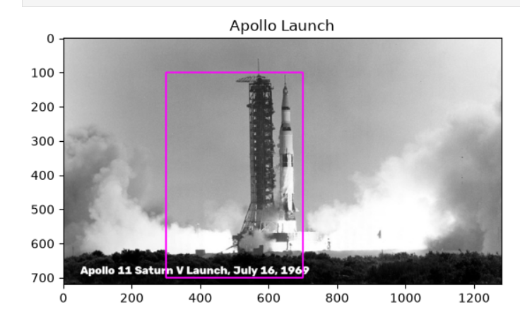

- **ii)** Adjust Image Brightness.  

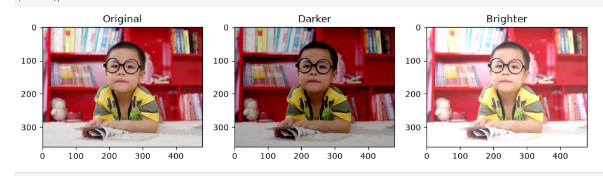

- **iii)** Modify Image Contrast.  

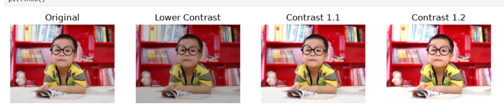
- **iv)** Generate Third Image Using Bitwise Operations.

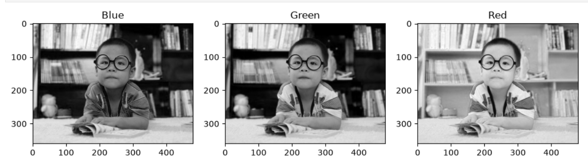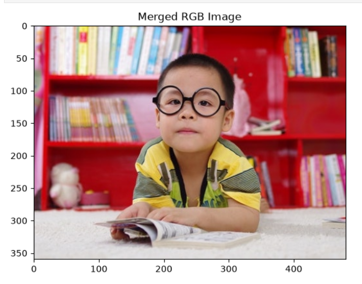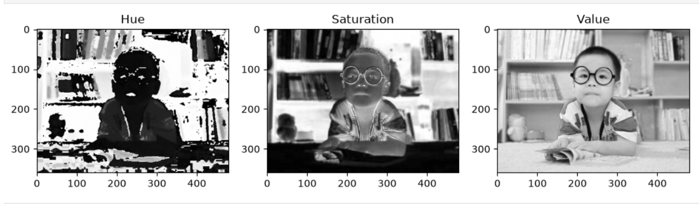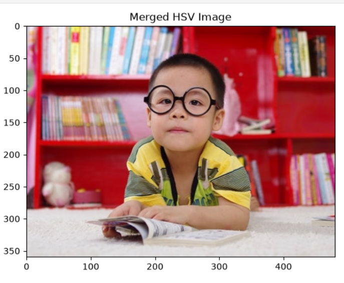

## Result:
Thus, the images were read, displayed, brightness and contrast adjustments were made, and bitwise operations were performed successfully using the Python program.
